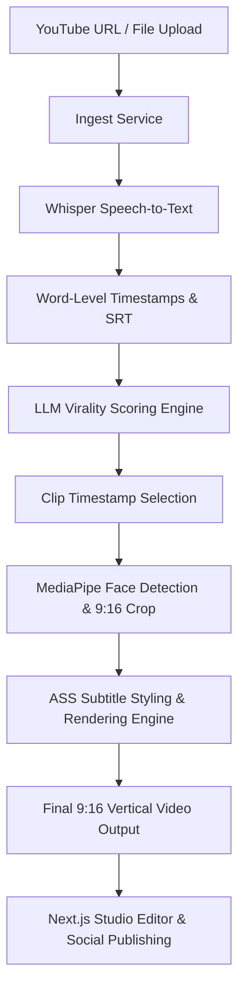

# 🎬 AI-CLIP (Teek) — Open-Source AI Video Clipping Engine

[](LICENSE)
[](https://python.org)
[](https://fastapi.tiangolo.com)
[](https://nextjs.org)
[](https://github.com/openai/whisper)
[](docker-compose.yml)

> **AI-CLIP** is a full-featured, self-hosted, open-source AI video clipping engine built as a powerful alternative to OpusClip, Veed.io, and Caption.com. Automatically transform long-form YouTube videos or local uploads into viral, vertical 9:16 short clips styled with animated captions, speaker framing, and viral-hook AI scoring.

---

## ✨ Features At A Glance

- 🧠 **Multi-LLM Clip Intelligence**: Supports OpenAI (`gpt-5-mini`), Anthropic (`claude-3-5-sonnet`), Google Gemini (`gemini-2.5-flash`), DeepSeek, and ZhipuAI for transcript analysis and hook detection.
- 🎙️ **Local Speech-to-Text**: Powered by OpenAI Whisper for high-precision, multi-lingual, word-level timestamps (with optional AssemblyAI integration).
- 🎨 **Dynamic Animated Subtitles**: Custom ASS subtitle engine with word-by-word highlight animations, customizable typography, and full RTL language support (Hebrew, Arabic, Persian).
- 👤 **Smart Face Tracking & Framing**: MediaPipe + OpenCV fallback for automatic speaker tracking and 9:16 aspect ratio framing.
- ✂️ **Interactive Studio Editor**: Fine-tune clip start/end timestamps, adjust caption positions, switch visual presets, and preview clips side-by-side with original video timelines.
- 🚀 **Campaign Automation**: Set up batch clipping automation for YouTube channels and social media pipelines.
- 🚫 **100% Watermark-Free & Unlimited**: Self-hosted privacy with zero paywalls, usage caps, or forced watermarks.

---

## 📊 AI-CLIP vs Proprietary Tools

| Feature | ⚡ AI-CLIP | 🔒 OpusClip / Veed |
| :--- | :--- | :--- |
| **Pricing** | **100% Free & Self-Hosted** | $15–$29/month subscription |
| **Watermarks** | **None** | Mandatory on free tiers |
| **Transcription Provider** | **Local Whisper** / AssemblyAI | Proprietary cloud only |
| **AI LLM Selection** | **Any LLM** (OpenAI, Gemini, Claude, DeepSeek) | Fixed proprietary model |
| **Aspect Ratio Framing** | **MediaPipe + OpenCV** (Local face detection) | Cloud face crop behind paywall |
| **Caption Customization** | **Full control** (Hype, Retro, Classic, ASS styles) | Limited presets |
| **RTL Language Support** | **Full RTL Support** (Arabic, Hebrew, Persian) | Broken or partial |
| **Source Code** | **Open Source** (AGPL-3.0) | Closed Source |

---

## 🖼️ Interface & Screenshots

| Dashboard | Studio Editor |
| :---: | :---: |
|  |  |

| Clip Review Grid | Caption Customization |
| :---: | :---: |
|  |  |

---

## 🏗️ System Architecture



---

## 🚀 60-Second Quick Start

### Prerequisites
- Docker & Docker Compose **or** Python 3.10+ & Node.js 20+
- FFmpeg installed on host (if running outside Docker)

### Setup Instructions

1. **Clone the repository**:
   ```bash
   git clone https://github.com/RobinBroG/AI-CLIP.git
   cd AI-CLIP
   ```

2. **Configure environment variables**:
   ```bash
   cp .env.sample .env
   ```
   Add your preferred LLM API Key in `.env`:
   ```env
   LLM=openai:gpt-5-mini
   OPENAI_API_KEY=your_openai_api_key_here
   ```

3. **Start services via Docker**:
   ```bash
   ./start.sh
   # or docker-compose up --build
   ```

4. **Access Applications**:
   - 🌐 **Frontend Studio App**: `http://localhost:3000`
   - ⚙️ **Backend FastAPI REST Service**: `http://localhost:8000`
   - 📖 **Interactive OpenAPI Docs**: `http://localhost:8000/docs`

---

## 📚 Documentation & Developer Guides

- 🚀 **Quick Start & Troubleshooting**: [`QUICKSTART.md`](file:///c:/Users/surya/teek/QUICKSTART.md)
- ⚙️ **Configuration Reference (Single Source of Truth)**: [`docs/config.md`](file:///c:/Users/surya/teek/docs/config.md)
- 🤖 **AI Agent & Architecture Reference Guide**: [`README_AI.md`](file:///c:/Users/surya/teek/README_AI.md)
- 🛠️ **Backend Specification**: [`backend/README.md`](file:///c:/Users/surya/teek/backend/README.md)

---

## 🛠️ Tech Stack

- **Backend**: FastAPI, PyTorch, OpenAI Whisper, MediaPipe, OpenCV, FFmpeg, Celery, Redis, PostgreSQL
- **Frontend**: Next.js 15, React 19, TypeScript, Tailwind CSS, Lucide Icons, HTML5 Canvas ASS Renderer
- **Orchestration**: Docker, Docker Compose, Uvicorn

---

## 📄 License

Distributed under the **AGPL-3.0 License**. See [`LICENSE`](file:///c:/Users/surya/teek/LICENSE) for more information.
